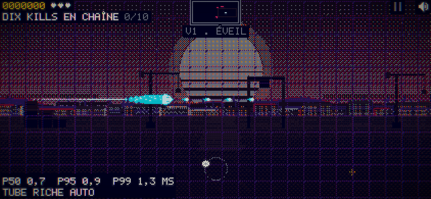
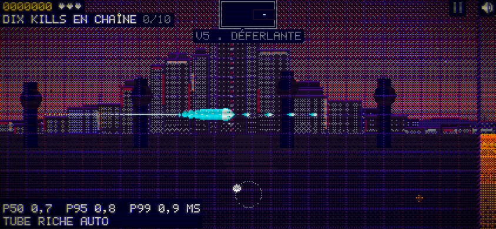
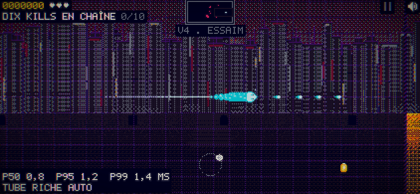
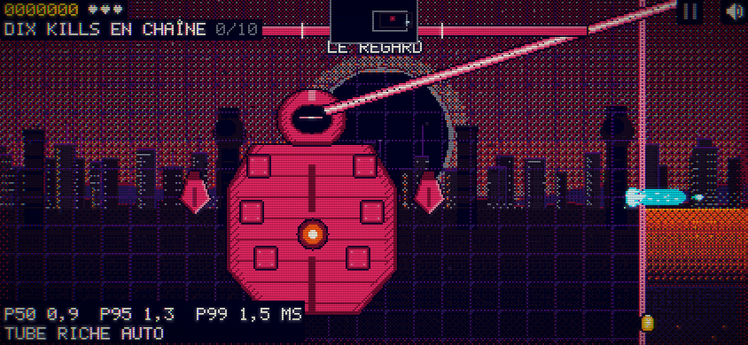

# codex-03 — le décor suit les événements

18/10/2026 · 00 h 10 (Paris)

**Branchement livré ; palier non validé : minimum de lumière du CYCLOPE sous le seuil.** Source : [apres.json](apres.json), douze cas collectés, `conforme: false`. L’ordre demandait quatre états ; les trois profils de codex-01 sont conservés.

## Changement et preuve de branchement

Une seule ligne ajoutée à `partie()` de `src/79-jeu.js` appelle `N.decor.build()` par le gestionnaire d’erreurs existant. La fonction est idempotente et branche les consommateurs d’événements ; elle est rappelée au démarrage d’une nouvelle partie, sans multiplier les abonnements. Le fichier a été réservé puis libéré immédiatement (commit source `d3938e6`, bundle `b51b3d1`) pour laisser Claude travailler sur les dépendances des pilotes.

Le directeur appliquait déjà directement l’état et le quartier des vagues via `N.decor.etat/quartier` : calme et chaos étaient donc déjà observables avant ce branchement. Les changements prouvés ici sont le passage de chaos à inversion lors de `inversionDebut()` et le passage à colosse/éclipse à l’arrivée du CYCLOPE. Les champs `decor`, `quartier` et les captures le montrent.

Le banc commun [banc.mjs](../lisibilite/banc.mjs) accepte désormais `--scenes --outdir`. Cette extension a été emportée sans modification dans le commit de réservation `db92a5a` par Claude Mac, qui l’a signalé dans `COORDINATION.md` ; son contenu a été vérifié ici.

## Mesures

Sources : [avant.json](avant.json), [apres.json](apres.json). Avant = bundle conservé avant l’ajout de l’appel ; après = bundle reconstruit avec cet ajout et les pilotes inactifs. Graine 2975, navigateur muet. Calme/chaos après cinq secondes de jeu ; inversion déclenchée par l’API publique de la joueuse, puis une seconde ; CYCLOPE par `dbg.boss()`, puis cinq secondes. Chaque événement traverse le jeu : aucun `N.decor.fixer/etat` forcé par le banc.

| Profil | Cas | Décor avant → après | Sol chaud % ≤ 3 | Sol L > 0,25 % ≤ 8 | Ciel L > 0,10 % ≥ 12 | Ciel chaud % ≤ 12 | p95 avant → après ms |
|---|---|---|---:|---:|---:|---:|---:|
| paysage | calme | calme → calme | 0,00 | 0,00 | 19,35 | 1,07 | 0,90 → 0,90 |
| paysage | chaos | chaos → chaos | 0,00 | 0,00 | 21,55 | 0,77 | 0,90 → 0,80 |
| paysage | inversion | chaos → inversion | 0,00 | 0,00 | 17,08 | 0,10 | 1,00 → 1,20 |
| paysage | cyclope | chaos → colosse | 0,00 | 0,16 | 11,71 | 0,83 | 1,40 → 1,30 |
| portrait | calme | calme → calme | 0,00 | 0,00 | 15,65 | 0,53 | 1,10 → 1,00 |
| portrait | chaos | chaos → chaos | 0,00 | 0,00 | 20,76 | 0,68 | 0,90 → 0,90 |
| portrait | inversion | chaos → inversion | 0,00 | 0,00 | 14,79 | 0,02 | 1,00 → 1,10 |
| portrait | cyclope | chaos → colosse | 0,00 | 0,00 | 9,78 | 0,33 | 1,30 → 1,20 |
| bureau | calme | calme → calme | 0,00 | 0,00 | 22,39 | 0,60 | 4,10 → 3,50 |
| bureau | chaos | chaos → chaos | 0,00 | 0,00 | 21,85 | 0,51 | 3,50 → 3,30 |
| bureau | inversion | chaos → inversion | 0,00 | 0,00 | 17,15 | 0,02 | 3,70 → 4,20 |
| bureau | cyclope | chaos → colosse | 0,00 | 0,11 | 10,90 | 1,17 | 3,50 → 3,60 |

Les douze cas ont zéro erreur du jeu et zéro erreur console/page. Les états attendus sont observés dans les douze cas. Sous l’horizon, les deux plafonds restent respectés ; le plafond chaud au-dessus de l’horizon aussi. Le delta p95 paysage reste sous +0,5 ms dans chacun des quatre cas. Les seules non-conformités sont les trois minimums de lumière du CYCLOPE : **11,71 % paysage, 9,78 % portrait, 10,90 % bureau**, contre 12 % demandé.

Avant branchement, le décor restait chaos/cœur devant le CYCLOPE : ces captures ne prouvaient donc pas l’éclipse. Après branchement, l’éclipse réelle éteint les fenêtres et le soleil, et le plancher de lumière échoue. Ces valeurs ne sont ni arrondies à une réussite ni compensées par un changement silencieux du seuil.

## Reproduction et limite

```sh
node tools/lisibilite/banc.mjs --scenes --outdir tools/decor-suivi --phase avant --bundle /tmp/snake-codex03-avant.html
node tools/lisibilite/banc.mjs --scenes --outdir tools/decor-suivi --phase apres
```

Les SHA-256 des bundles sont dans les reçus. Le banc après retourne 1 pour la non-conformité. Même méthode de tampon indexé et origines écran/monde que codex-01. Mesures Chromium sur ce Mac avec profils émulés ; pas un iPhone matériel ni Safari. Les empreintes hors jeu ne sont pas des critères avant/après de cette suite : les contextes inversion/éclipse sont précisément différents avant et après le correctif.

## Captures et reprise

Les douze captures après ont été regardées en planche comparative. Les quatre scènes diffèrent visuellement ; la ville et le sol restent plus calmes que les acteurs. Le disque noir de l’éclipse et la ville très éteinte sont visibles pendant le CYCLOPE. Captures normales avant/après jointes ; revue indépendante Claude attendue.









**Lot arrêté pour arbitrage Claude.** Reste : décider si l’éclipse garde le minimum de 12 % (alors éclairer explicitement quelques détails froids du lointain) ou reçoit une exception artistique explicite. Aucune autre source ni règle du jeu n’a été modifiée pour faire passer ce seuil. Après réponse dans « Ordres pour Codex », reprendre seulement les cas affectés.
