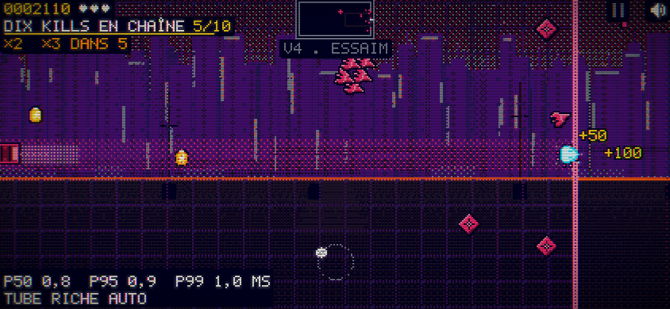
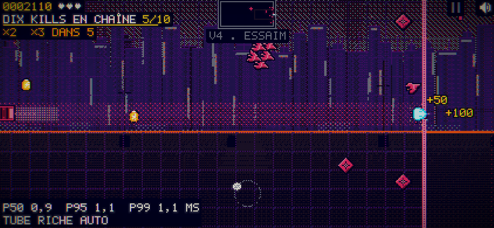

# codex-01c — diagnostic après deux précontrôles

18/10/2026 · 00 h 45 (Paris).

**Lot arrêté sur la méthode actuelle : le minimum de ciel lumineux échoue. Aucun changement de 15-decor.js n’a été livré pour 01c.** Le sol plein écran 01b et le pilote 02 acceptés sont conservés.

## Essais ciblés (avant dépense de jury)

Scène V4, profil paysage 844 × 390, graine 4242, 30 secondes de jeu, quinze instantanés depuis draw() après drawFront et avant les acteurs. Même banc que 01b, sorti dans un répertoire séparé. Il s’agit de deux précontrôles sur un seul cas ; les 315 relevés et les deux juges neufs demandés ne sont pas annoncés faits.

- **Méthode 1**, application directe de l’option A : fenêtres violettes/indigo, façades violettes/indigo, soleil plein jaune/ambre, deux rangées d’horizon en brasier. Ciel lumineux au plus bas : **5,69 %**, seuil 12 %. Sol chaud : 0 %, sol lumineux ≤ 0,28 %, zéro erreur. Source : [naif-apres.json](naif-apres.json).
- **Méthode 2**, différente : façades au premier plan en indigo (ombres nuit conservées), même soleil et horizon ; redistribuer une partie de la brume sang en éclaircie froide acier, sans repeindre les fenêtres en gris. Ciel lumineux au plus bas : **8,58 %**, seuil 12 %. Sol chaud : 0 %, sol lumineux ≤ 0,28 %, zéro erreur. Source : [halo-apres.json](halo-apres.json).

Les deux minimas échouent ; aucun seuil n’est assoupli et aucun jury n’est lancé pour valider un candidat qui échoue déjà au précontrôle. Les sources expérimentales sont dans prototypes/ ; elles ne sont ni des modules de src/ ni des scripts du jeu publié. Les bundles de travail restent /tmp/snake-option-a.html et /tmp/snake-option-a-v2.html, identifiés par SHA-256 dans les reçus.

## Diagnostic

La table officielle 00-pal.js donne à violet et indigo des luminances respectives de 0,041 et 0,024, sous le seuil de pixel lumineux 0,10. Colorer ainsi les fenêtres retire donc leur contribution lumineuse ; dans les TOURS, la cité masque une grande partie du soleil. La prise dans draw() confirme le manque sur cette scène. Le prototype d’éclaircie froide remonte la lumière mais reste sous le minimum. Ajouter encore de l’acier pour remplir le quota risque de reproduire précisément le ciel gris que l’option A veut éviter : c’est une hypothèse artistique, pas une note de jury.

L’option A nécessite une méthode de lumière explicitée : conserver davantage d’enseignes/contours lumineux, déplacer la lumière vers une zone de ciel dégagée, ou rendre le minimum de lumière indicatif comme pour R-11. Ces voies ne sont pas appliquées d’office au référentiel ; la question est dans la boîte aux lettres de Claude.

Reste : arbitrage de la cheffe d’orchestre sur la méthode, preuve sur un seul cas avant une nouvelle passe complète, puis 315 relevés et deux juges neufs. Reprise sans réexécuter les mesures 01b et 02 inchangées. Aucun achat ni appel d’API d’IA facturé.
