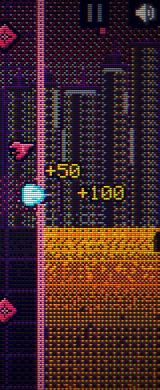
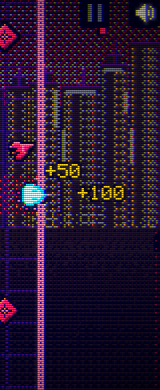
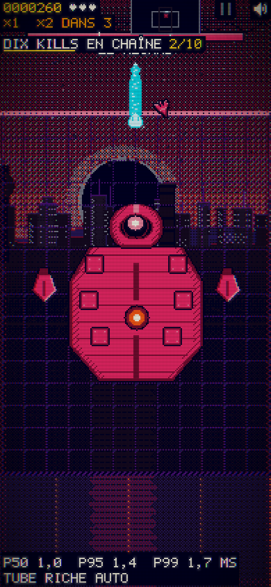
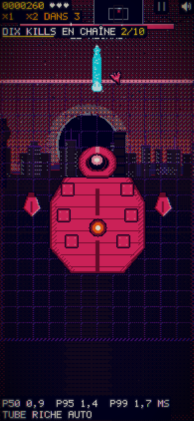

# codex-01b — sol calme jusqu’aux bords de l’écran

18/10/2026 · 00 h 23 (Paris).

**Critères techniques du lot tenus sur le bundle figé : 270 relevés demandés et 45 relevés DÉFILÉ supplémentaires.** Source : [01b/apres.json](01b/apres.json), `collecteComplete: true`, `conforme: true`. Revue Claude `/mediateur` attendue. Aucun avis artistique n’est remplacé par ces mesures.

## Changement

Seul `src/15-decor.js` est modifié parmi les sources de ce lot. Le remappage du sol en jeu parcourt désormais le tampon de l’horizon jusqu’au bas de l’écran, sur toute sa largeur, indépendamment de N.world et des murs mobiles. Le mur rose, la grille, les acteurs et leurs tirs sont dessinés ensuite. La bande chaude au-delà du plateau disparaît ; les tables de couleurs restent identiques.

`defile` est ajouté à `enJeu()`. **`attraction` reste hors jeu**, comme demandé ; les autres états hors jeu gardent leur rendu. Les boucles et tables qui dessinent le ciel, le soleil et la cité au-dessus de l’horizon ne sont pas modifiées. Leur ambiance reste celle de la livraison précédente, en attente du choix de Manon.

## Méthode et périmètre des preuves

[banc-01b.mjs](banc-01b.mjs) reprend la prise d’instantané du médiateur : le tampon est copié depuis le `draw()` normal du jeu, juste après `N.decor.drawFront`, avant les acteurs. Aucune redessin séparé ne remplace ce relevé. Les murs propres au décor et la grille sont donc inclus.

Graine 4242 ; Playwright/Chromium muet, rAF piloté à 60 Hz, __DT=1/60 ; iPhone 13 paysage 844 × 390, portrait 390 × 844, bureau 1440 × 900. Vagues 1 à 5 et boss : 30 secondes de jeu chacun, relevés aux cibles 2, 4, …, 30 s, soit 270. Trois cas `defile` supplémentaires apportent 45 relevés ; cet état est posé par `dbg.etat('defile')` pour contrôler le rendu, ce qui ne prouve pas que le DÉFILÉ est déjà accessible dans la progression normale du jeu.

Sous l’horizon (`y > horizon`), les plafonds sont mesurés sur **tout l’écran** : chaud ≤ 3 %, luminance > 0,25 ≤ 8 %. Au-dessus : chaud ≤ 12 % ; lumineux ≥ 12 %, avec l’exception **≥ 8 % pendant l’éclipse du CYCLOPE** explicitement publiée par Claude Mac à l’ordre 3. Les seuils antérieurs restent dans leurs reçus historiques ; aucune autre exception n’est ajoutée.

Les bundles sont identifiés par SHA-256 dans [01b/avant.json](01b/avant.json) et [01b/apres.json](01b/apres.json). Ils sont figés par le serveur du banc. Ils précèdent l’intégration en cours du lot I de Claude (vues S et simulation des pilotes) ; cette mesure qualifie le correctif de décor dans ces instantanés, pas toute modification ultérieure des autres modules.

## Résultats avant → après

Maxima du sol sur les quinze relevés de chaque cas ; minimum de ciel lumineux après. Source : les deux reçus JSON.

| Profil | Cas | Sol chaud % ≤ 3 | Sol L > 0,25 % ≤ 8 | Ciel lumineux min % | Δ p95 paysage ms ≤ +0,5 |
|---|---|---:|---:|---:|---:|
| paysage | v1 | 4,19 → 0,00 | 4,47 → 0,28 | 19,16 | -0,10 |
| paysage | v2 | 5,04 → 0,00 | 5,31 → 0,28 | 20,89 | -0,30 |
| paysage | v3 | 5,99 → 0,00 | 6,24 → 0,28 | 21,37 | -0,10 |
| paysage | v4 | 5,98 → 0,00 | 6,26 → 0,28 | 15,12 | -0,10 |
| paysage | v5 | 6,04 → 0,00 | 6,29 → 0,28 | 20,30 | -0,10 |
| paysage | boss | 2,57 → 0,00 | 2,96 → 0,39 | 11,44 | -0,10 |
| paysage | defile | 44,23 → 0,00 | 44,51 → 0,28 | 15,12 | -0,10 |
| portrait | v1 | 0,00 → 0,00 | 0,00 → 0,00 | 15,24 | — |
| portrait | v2 | 1,99 → 0,00 | 1,99 → 0,00 | 13,10 | — |
| portrait | v3 | 2,19 → 0,00 | 2,19 → 0,00 | 19,37 | — |
| portrait | v4 | 0,00 → 0,00 | 0,00 → 0,00 | 15,38 | — |
| portrait | v5 | 2,38 → 0,00 | 2,38 → 0,00 | 20,38 | — |
| portrait | boss | 0,21 → 0,00 | 0,21 → 0,00 | 10,62 | — |
| portrait | defile | 30,20 → 0,00 | 30,20 → 0,00 | 15,38 | — |
| bureau | v1 | 3,98 → 0,00 | 4,21 → 0,23 | 22,41 | — |
| bureau | v2 | 4,80 → 0,00 | 5,03 → 0,23 | 22,64 | — |
| bureau | v3 | 5,62 → 0,00 | 5,86 → 0,23 | 24,79 | — |
| bureau | v4 | 5,72 → 0,00 | 5,95 → 0,26 | 16,01 | — |
| bureau | v5 | 5,56 → 0,00 | 5,80 → 0,23 | 21,28 | — |
| bureau | boss | 1,88 → 0,00 | 2,21 → 0,33 | 11,19 | — |
| bureau | defile | 42,30 → 0,00 | 42,53 → 0,26 | 16,01 | — |

Après : **0,00 % de pixels chauds sous l’horizon dans les 315 relevés** ; luminance > 0,25 au plus **0,39 %**. Le ciel reste au minimum à **13,10 %** hors éclipse, **10,62 %** pendant l’éclipse ; le chaud du ciel atteint au plus **2,12 %**. Cyan/cyan pâle du décor : zéro pixel. Erreurs du jeu, console et page : zéro dans les 21 cas.

Dans les six scènes déjà couvertes, **les 270 empreintes du ciel sont identiques avant/après**, relevé par relevé. Pour `defile`, l’ambiance existante des états jouables est appliquée pour la première fois ; elle n’est pas redessinée ni réglée. Les six états hors jeu (ouverture, titre, VOL, victoire, cartes, attraction) conservent leurs empreintes dans les 21 contextes : 126 comparaisons.

## Coût et vérifications

L’écart p95 paysage reste entre −0,30 et −0,10 ms, sous la limite de +0,5 ms ; ces petites baisses ne sont pas présentées comme un gain de performance établi. Les valeurs viennent de `window.__S.perf.p95` avec `?perf=1`, dans Chromium émulé sur ce Mac, pas d’un iPhone physique ni de Safari.

Deux collectes se sont brièvement chevauchées à la fin de la passe AVANT. La passe APRÈS paysage a donc été refaite **seule, après fin confirmée de la passe AVANT** ; ce sont ses valeurs qui figurent dans le reçu final (`reprises`). Les autres relevés de couleurs, issus de l’horloge contrôlée et de bundles figés, sont conservés ; les coûts du bureau et du portrait ne servent pas au seuil de performance.

`node build.mjs` : sortie 0, syntaxe du bundle contrôlée ; `node --check tools/lisibilite/banc-01b.mjs` et `git diff --check` passent. Le banc avant sort 1 (plafond plein écran et DÉFILÉ non tenus) ; le banc après sort 0.

## Captures regardées

Le bord droit paysage V4 et le portrait boss ont été inspectés avant/après. La bande orange accolée au mur est remplacée par un sol sombre ; le mur et les effets des acteurs gardent leurs couleurs. Le ciel conserve ses pixels. Captures normales et recadrage du bord droit sont joints ; aucune retouche d’image n’intervient.









## Reproduction et reprise

```sh
# Depuis proto-neon/. Avant : bundle conservé avant le correctif.
node tools/lisibilite/banc-01b.mjs --phase avant --bundle /tmp/snake-codex01b-avant.html
node tools/lisibilite/banc-01b.mjs --phase apres --bundle /tmp/snake-codex01b-apres.html
# Refaire un seul profil, en conservant les autres cas du même bundle :
node tools/lisibilite/banc-01b.mjs --phase apres --bundle /tmp/snake-codex01b-apres.html --profils paysage --reprendre
```

Objectif technique du lot vérifié sur les instantanés ci-dessus ; source et preuves prêtes pour livraison. Aucune dépense externe. Reste : synchroniser le bundle avec les fichiers que Claude modifie en parallèle, libérer la réservation lors de la livraison, et attendre sa revue. Prochaine action après push : pull et relecture intégrale de « Ordres pour Codex » ; reprendre codex-02 dès que le lot I est livré.
