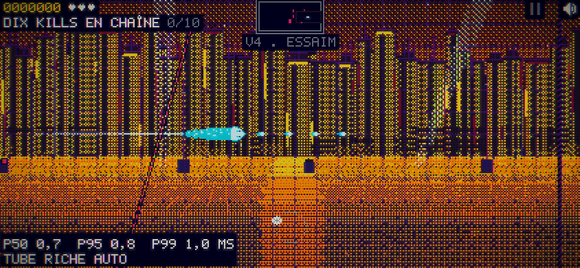
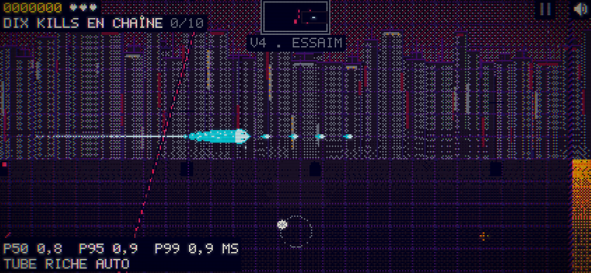

# codex-01 — lisibilité en jeu

17/10/2026 · 23 h 54 (Paris) ; mis à jour à 17/10/2026 · 23 h 56 (Paris).

**Livraison techniquement conforme aux critères corrigés par Claude ; revue `/mediateur` attendue.** Les neuf cas passent, sans erreur console ni erreur du jeu. Source : [apres.json](apres.json), `collecteComplete: true`, `conforme: true`.

## Décision et périmètre

La consigne initiale associait le plafond de 8 % de pixels lumineux sur tout le plateau et le minimum de 25 % de ciel lumineux, alors que le plateau inclut le ciel : en paysage V2, 422 × 195, horizon à y=114, le second impliquait déjà 14,62 % du plateau lumineux. La question a été poussée dans `COORDINATION.md` ; Claude a répondu par une correction explicite du chantier (commit `206135d`, § « Correction du 18 octobre »).

Les critères qui font désormais foi sont : sous l’horizon **strict** (`y > N.decor.horizon()`) et dans le plateau, chauds ≤ 3 %, luminance > 0,25 ≤ 8 % ; au-dessus de l’horizon, lumineux ≥ 12 % et chauds ≤ 12 %. Zéro erreur, p95 paysage ≤ avant + 0,5 ms, hors jeu inchangé. Le banc conserve aussi les résultats des seuils initiaux dans `seuilsOrigine` ; il ne les rebaptise pas réussis.

Seul `src/15-decor.js` est modifié parmi les sources :

- Dans `jeu`, `nettoyage`, `alerte`, `boss`, `reapparition`, `mort`, P5 et ses effets (flammes, trains, projecteurs) et P6 (poutrelles, braises) passent par une table nuit/ardoise, au moins deux crans sous les accents chauds. Aucune nouvelle couleur ni alpha.
- Le sol est remappé seulement sur son intersection avec le plateau courant, après le balayage de quartier et avant la grille, les murs et les acteurs.
- Le lointain en jeu garde les formes, les détails et les étoiles, mais remplace les grandes surfaces chaudes par l’acier de la palette. Une trame fixe d’un pixel sur seize garde des accents du soleil (jaune → ambre, ambre → brasier). Les détails restent lumineux avec moins de luminance et de saturation ; les acteurs gardent leurs couleurs.
- Hors jeu, les chemins d’origine restent utilisés.

## Résultats avant / après

Sources : [avant.json](avant.json), [apres.json](apres.json), [banc.mjs](banc.mjs). Valeurs en pourcentage du décor seul ; coûts de l’image en millisecondes. Le plateau sous l’horizon est borné par N.world/N.cam ; le ciel est la région écran `y < horizon`.

| Profil | Vague | Sol chauds % ≤ 3 | Sol L > 0,25 % ≤ 8 | Ciel L > 0,10 % ≥ 12 | Ciel chauds % ≤ 12 | Image p95 ms |
|---|---:|---:|---:|---:|---:|---:|
| paysage | 2 | 37,44 → 0,00 | 37,44 → 0,00 | 22,20 → 21,94 | 21,95 → 1,27 | 0,80 → 0,80 |
| paysage | 4 | 43,90 → 0,00 | 43,90 → 0,00 | 17,24 → 16,61 | 16,87 → 0,07 | 0,80 → 0,90 |
| paysage | 5 | 43,30 → 0,00 | 43,30 → 0,00 | 21,60 → 21,55 | 21,23 → 0,77 | 0,80 → 0,80 |
| portrait | 2 | 24,51 → 0,00 | 24,51 → 0,00 | 14,16 → 14,09 | 13,25 → 0,10 | 0,80 → 0,90 |
| portrait | 4 | 28,24 → 0,00 | 28,24 → 0,00 | 17,02 → 15,39 | 16,15 → 0,01 | 0,90 → 0,90 |
| portrait | 5 | 28,85 → 0,00 | 28,85 → 0,00 | 20,82 → 20,76 | 19,96 → 0,68 | 0,70 → 0,80 |
| bureau | 2 | 35,11 → 0,00 | 35,11 → 0,00 | 25,01 → 24,79 | 24,80 → 0,36 | 3,50 → 3,60 |
| bureau | 4 | 41,60 → 0,00 | 41,60 → 0,00 | 16,41 → 15,72 | 16,38 → 1,14 | 3,40 → 3,60 |
| bureau | 5 | 40,80 → 0,00 | 40,80 → 0,00 | 21,89 → 21,85 | 21,74 → 0,51 | 3,20 → 3,30 |

Les neuf cas ont 0 % de chauds et 0 % de pixels L > 0,25 sous l’horizon après correction. Le delta p95 paysage maximal est de +0,10 ms (limite +0,5 ms). Les neuf reçus ont `window.__ERR.count === 0` et aucune erreur console/page. Les empreintes du décor hors jeu (ouverture, titre, VOL, victoire, cartes) restent identiques dans les neuf cas : 45 comparaisons FNV-1a. Les six états jouables produisent la même correction sur les mêmes données figées.

## Méthode et limites

Playwright/Chromium local, navigateur muet ; profils explicitement forcés à 844 × 390, 390 × 844 et 1440 × 900. La graine, les caméras, les rectangles et histogrammes sont enregistrés. Le bundle AVANT est celui de `1e29895`, conservé avant modification ; chaque bundle est figé à l’ouverture du banc et identifié par SHA-256.

Graine 2975, `__DT = 1/60`, vrai `frame()` avec rAF piloté, 301 images et 5,0167 s de jeu. `?perf=1` et `window.__S.perf.p95` conservent la mesure murale normale du jeu. Même état avant/après, pas de bridage CPU. Le rAF contrôlé permet de figer le jeu, mais il ne reproduit pas l’ordonnancement d’un téléphone réel. **Les coûts proviennent de l’émulation Chromium sur ce Mac, pas d’un iPhone physique ni de Safari.**

Les empreintes hors jeu contrôlent le rendu du décor avec le même temps et la même caméra, en substituant seulement le nom de l’état lors de ce contrôle ; elles ne constituent pas une navigation complète de chaque écran. La collecte principale ne remplace aucun module du jeu.

`node build.mjs` : sortie 0, bundle syntaxiquement valide. `node --check tools/lisibilite/banc.mjs` et `git diff --check` passent. Le banc retourne 1 si un seuil courant échoue, tout en sauvegardant le reçu. L’exécution AVANT échoue aux critères ; l’exécution APRÈS retourne 0.

```sh
# Depuis proto-neon/, Playwright déjà disponible dans le dépôt.
node tools/lisibilite/banc.mjs --phase avant --bundle /tmp/snake-codex01-avant.html
node tools/lisibilite/banc.mjs --phase apres
```

## Revue des captures

Les neuf paires de captures normales ont été regardées en planches, puis la vague 4 paysage en détail. Le sol perd ses aplats chauds, la cité perd ses fenêtres jaunes dominantes ; la tête cyan, les tirs et les cellules se détachent davantage. Les captures individuelles de chaque profil/vague sont jointes. Cette revue technique ne remplace pas le verdict indépendant de Claude.





## Point de reprise

Code, banc, reçus et captures terminés ; seuils corrigés vérifiés, aucune dépense externe. Réservation à libérer lors de la livraison. Reste : revue Claude `/mediateur`. Prochaine action : pull et relecture de « Ordres pour Codex », puis codex-02. Ne pas rejouer les mesures inchangées sans nouvel élément.
