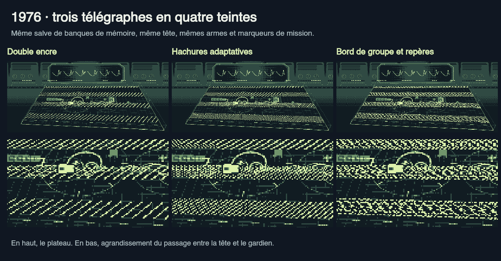

# 18/11/2026 · 00 h 44, Paris

Le rendu hybride, le télégraphe phosphore et l’articulation sont intégrés aux fichiers actifs du laboratoire. La chambre charge les modules de locomotion et de lisibilité avant le premier dessin. Les fichiers de correctif et le sous-dossier `recette/` témoignent du prototype précédant cette intégration.

## Rendu par époque

| Année | Surface de tracé | Présentation |
|---|---|---|
| 1976 | Pleine définition DPR 2 | Quantification à quatre teintes, largeur logique maximale 384 px |
| 1985 | Surface logique, maximum 480 px | Palette 16 teintes, agrandissement unique |
| 1995 | Pleine définition DPR 2 | RGB332, largeur maximale 568 px |
| 2185 | Surface logique, maximum 768 px | RGB565, agrandissement unique |
| 2985 | Pleine définition DPR 2 | RGBA natif |

Les surfaces logiques réutilisent leur tampon par canevas. Le traitement de palette se fait avec une matrice d'identité, puis rétablit la matrice précédente. La matière peinte, les poses des gardiens, la piste de surf et les archives suivent la surface de l’époque. Les sprites reçoivent toujours la largeur CSS de la vue réelle.

## Télégraphie et rôle de la tête

Le marquage utilise l’union des vraies clés de collision des vagues écologiques et du gardien par plan. À froid, le rendu rasterise chaque case projective à la résolution du phosphore. Il réserve un tiret à double encre à l’intérieur de chaque case et marque les frontières extérieures du groupe. De petits repères complètent les entrées lorsque le motif seul manquerait de contraste. L’orientation des tirets distingue la préalerte et le tir actif. Un déplacement, un roulis ou un zoom affine réutilise la couche en cache.

Les segments reçoivent la pose articulée `joint`, l’angle et l’échelle calculés pour leur époque. Les raccords entre plans précèdent les sprites du corps et les impulsions suivent leur tracé. La tête contrôlée est posée une fois, à opacité pleine, sur le centre et le plan fournis par le moteur. Une bordure sombre d’un pixel de l’atlas phosphore la distingue des hachures. Les guides tactiques, le marqueur de surf, les archives et le nœud conservent leurs appels de dessin.

## Épreuve de surface

Huit scènes peuplées couvrent des lignes, des banques, un portier et des attaques mêlées sur les deux plans. Chaque scène porte des projectiles, des effets, des sprites et des repères tactiques. Les deux formats mesurent 568 × 284 et 740 × 328 pixels CSS avec un DPR de 2. Le moteur de tracé hors navigateur est Skia. Chaque case est comparée à une image témoin identique où le seul marquage est masqué.

Dans chaque région utile, au moins 15 % des échantillons doivent être clairs et 15 % sombres, avec un contraste minimal de 3:1 entre ces groupes. La région centrale et les entrées mises en commun passent le test indépendamment. Le canal alpha d’un dessin indépendant du sprite et de sa bordure protège les pixels réellement occupés par la tête. Sur 1 580 observations, 20 ont moins de deux pixels libres dans l’une des régions. La tête y garde la priorité.

| Marquage | Centre et entrées · 1 560 zones observables | Chacun des quatre bords |
|---|---:|---:|
| Diagonale à double encre | 1 146 | 790 |
| Hachures adaptatives | 1 481 | 1 173 |
| Bord de groupe, tirets et repères | **1 560** | **1 475** |

Le résultat porte sur les surfaces visibles de ces scènes. L’épreuve plus stricte exigeant un contraste sur chacun des quatre bords laisse 85 observations à examiner. La comparaison avec le témoin attribue séparément au marquage une différence d’au moins 3:1 sur 15 % des pixels dans 1 552 centres et 1 558 entrées. Une partie des pixels du témoin possède déjà la même teinte que le motif.

La même variante dessinée directement à 384 px franchit le test central et d’entrée dans 1 559 cas sur 1 560. Le chemin retenu pour 1976 demeure le tracé à DPR 2 suivi de la présentation phosphore. Le seuil de surface est une hypothèse de recette. La reconnaissance en situation de jeu demande une vérification humaine.

## Vérifications

- `node integration.cjs` vérifie les dix combinaisons année/plan, les largeurs, le rappel des matières, les poses du boss, les effets et la position exacte de la tête. Cinq démarrages sans modules facultatifs vérifient les replis.
- `node comparer.cjs` reproduit la comparaison sur le code actif et vérifie également les quatre combinaisons de plan de tête et de plan actif pendant la bascule.
- `node comparer.cjs --logique1976` évalue localement la variante phosphore en résolution logique.
- Sur une salve de 252 cases et 45 mesures après chauffe, le P95 du seul marquage est de 0,04 ms en cache et pendant le roulis, et de 2,45 ms avec une nouvelle orientation. Le chiffre décrit l’appel de tracé sous Skia sur le Mac. Les coûts sur iPhone dépendent de sa recette propre.

[Mesures par scène](mesures.json) · [Échantillons 1976 en résolution logique](mesures-logique.json) · [Rôles, opacité et coûts](roles-et-cout.json) · [Vérification d’intégration](integration.json)
