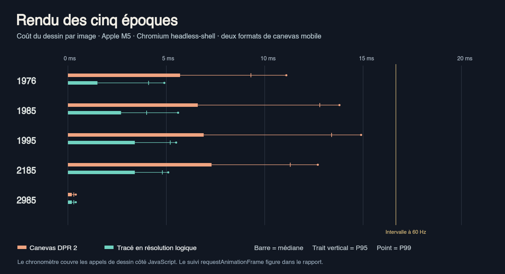
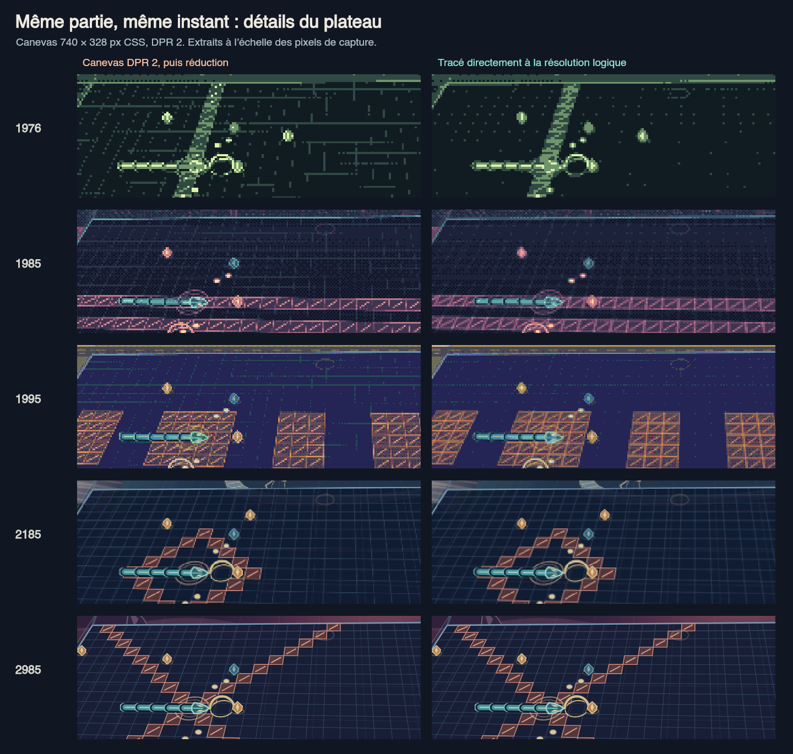

# 18/11/2026 · 00 h 30 · Endurance du rendu SNAKE 2985

Le même navigateur headless-shell a rendu **57 634 images** pendant **16,01 minutes** sur Apple M5. Les deux chemins ont joué les mêmes scénarios, avec les mêmes graines et des créneaux voisins. Les deux formats testés sont 740 × 328 et 568 × 284 pixels CSS, au DPR 2. Le Mac hébergeait aussi les travaux du projet. La température et la charge de fond ne sont pas contrôlées.

## Cadence et coût du rendu

Chaque ligne agrège les deux formats, quatre phases et les deux réglages de mouvement. La durée JavaScript inclut les appels Canvas synchrones, y compris la lecture des pixels pour les quatre anciennes époques. En 2985, le navigateur peut différer les commandes de dessin. Le coût GPU et la disponibilité réelle d’une image sur une dalle ne sont pas instrumentés.

| Année | Chemin | Images | JS P50 / P95 / P99 (ms) | rAF mesuré (Hz) | rAF P50 / P95 / P99 (ms) | Intervalles >25 / >50 ms | JS >25 / >50 ms |
|---|---|---:|---|---:|---|---:|---:|
| 1976 | dpr2 | 5 764 | 5,7 / 9,3 / 11,1 | 60,00 | 16,7 / 16,7 / 16,8 | 0 / 0 | 0 / 0 |
| 1976 | logique | 5 764 | 1,5 / 4,1 / 4,9 | 60,00 | 16,7 / 16,7 / 16,8 | 0 / 0 | 0 / 0 |
| 1985 | dpr2 | 5 764 | 6,6 / 12,8 / 13,8 | 60,00 | 16,7 / 16,7 / 16,8 | 0 / 0 | 0 / 0 |
| 1985 | logique | 5 764 | 2,7 / 4,0 / 5,6 | 60,00 | 16,7 / 16,7 / 16,8 | 0 / 0 | 0 / 0 |
| 1995 | dpr2 | 5 759 | 6,9 / 13,4 / 14,9 | 59,95 | 16,7 / 16,8 / 16,8 | 4 / 0 | 2 / 1 |
| 1995 | logique | 5 763 | 3,4 / 5,2 / 5,5 | 59,99 | 16,7 / 16,8 / 16,8 | 1 / 0 | 0 / 0 |
| 2185 | dpr2 | 5 764 | 7,3 / 11,3 / 12,7 | 60,00 | 16,7 / 16,7 / 16,8 | 0 / 0 | 0 / 0 |
| 2185 | logique | 5 764 | 3,4 / 4,8 / 5,1 | 60,00 | 16,7 / 16,7 / 16,8 | 0 / 0 | 0 / 0 |
| 2985 | dpr2 | 5 764 | 0,2 / 0,3 / 0,4 | 60,00 | 16,7 / 16,7 / 16,8 | 0 / 0 | 0 / 0 |
| 2985 | logique | 5 764 | 0,2 / 0,3 / 0,4 | 60,00 | 16,7 / 16,8 / 16,8 | 0 / 0 | 0 / 0 |

Les percentiles proviennent des histogrammes de toutes les mesures, à 0,1 ms près. Les comptes de dépassement utilisent les valeurs brutes. La fréquence rAF indique les rappels reçus. Cette configuration a cadencé le rendu autour de 60 Hz ; le protocole ne mesure pas un iPhone, une dalle 120 Hz ni les images effectivement présentées.

## Démarrage, changements de décor et allocations

Chaque chaîne conserve ses pièces de décor et tables de palette. La première colonne donne la toute première image de chaque année, la seconde la première image après dix autres changements d’époque sur le même format. Un chiffre par visite est une observation ponctuelle.

| Année | DPR 2 première / après 10 (ms) | Logique première / après 10 (ms) | Surfaces nouvellement créées après 10, DPR / logique | Réduction lue par image au format 740 px |
|---|---:|---:|---:|---:|
| 1976 | 12,0 / 12,7 | 11,7 / 7,0 | 0 / 0 | 255 Kio |
| 1985 | 20,0 / 10,6 | 11,7 / 2,1 | 0 / 0 | 399 Kio |
| 1995 | 20,8 / 7,8 | 18,2 / 8,7 | 0 / 0 | 559 Kio |
| 2185 | 20,5 / 7,5 | 10,5 / 4,5 | 0 / 0 | 1 020 Kio |
| 2985 | 3,3 / 0,2 | 4,0 / 0,2 | 0 / 0 | 0 Kio |

Le chemin DPR 2 trace la scène en haute définition, réduit son tampon vers une surface rétro, lit et quantifie cette surface, puis agrandit le résultat. La variante dessine directement à la largeur logique, conserve la lecture et la quantification de cette surface et effectue un seul agrandissement. En 2985 les chemins dessinent en résolution native. Les deux chemins relisent donc le même nombre de pixels rétro. Le témoin recopie en plus tout le canevas DPR 2 vers la surface rétro à chaque image.

Les compteurs observent **96 écritures** des propriétés de largeur ou de hauteur de canevas sur toute la campagne. Les lectures complètes allouent un ImageData par image rétro ; leur taille est indiquée ci-dessus. Le compteur ne recense pas les petites allocations des objets du moteur ni les allocations des pilotes.

| Après les cinq époques | Tas JS avant GC (Mio) | Tas JS après GC (Mio) | Octets rapportés pour les backing stores, après GC |
|---|---:|---:|---:|
| 1 | 5,02 | 2,09 | 711 089 |
| 2 | 2,64 | 2,09 | 711 089 |
| 3 | 4,90 | 2,09 | 711 089 |
| 4 | 4,18 | 2,09 | 711 089 |

Le RSS cumulé des processus identifiés navigateur, GPU, réseau et renderer varie de **242 à 393 Mio** dans les 68 relevés. L’échantillonnage système commence 2,6 minutes après le départ. Le RSS peut compter plusieurs fois les pages partagées. Les deux chaînes de rendu partagent le même processus. Les mesures du tas et les collectes forcées une fois par passage ne suffisent pas à prouver l’absence de fuite native.

## Fidélité des images appariées

Les captures utilisent le même gardien, la même graine et le même temps simulé. Le SSIM porte sur la luminance de pavés 8 × 8, moyenné sur le canevas entier. Il sert de comparaison avec le chemin actuel. Le contraste local est le rapport entre les luminances aux percentiles 95 et 10 d’une fenêtre centrée sur une case dangereuse isolée. Ce chiffre dépend du cadrage et des pixels d’arête ; la recette ne mesure pas la reconnaissance par des joueurs.

| Année | Largeur CSS | Pixels strictement identiques | SSIM | Contraste local tête DPR / logique | Contraste local danger DPR / logique |
|---|---:|---:|---:|---:|---:|
| 1976 | 568 | 94,5 % | 0,848 | 14,19 / 7,87 | 2,81 / 2,81 |
| 1985 | 568 | 89,8 % | 0,915 | 9,75 / 7,58 | 4,28 / 4,28 |
| 1995 | 568 | 94,0 % | 0,947 | 4,33 / 4,73 | 3,05 / 3,05 |
| 2185 | 568 | 83,1 % | 0,988 | 9,73 / 10,24 | 3,22 / 3,46 |
| 2985 | 568 | 100,0 % | 1,000 | 9,48 / 9,48 | 4,00 / 4,00 |
| 1976 | 740 | 93,5 % | 0,851 | 7,87 / 7,87 | 2,81 / 2,81 |
| 1985 | 740 | 88,0 % | 0,903 | 7,06 / 7,06 | 5,50 / 4,28 |
| 1995 | 740 | 91,5 % | 0,915 | 4,73 / 3,81 | 4,34 / 2,24 |
| 2185 | 740 | 82,9 % | 0,983 | 8,39 / 7,91 | 4,23 / 4,08 |
| 2985 | 740 | 100,0 % | 1,000 | 6,38 / 6,38 | 4,38 / 4,38 |

### Décision par époque

Le repère de 3:1 ci-dessous sert à repérer une dégradation sur la case instrumentée. Il constitue une hypothèse de recette, pas un seuil de réussite mesuré auprès de joueurs. Les gains indiqués sont les différences de médianes des quatre couples pris séparément, en millisecondes par image.

- **1976**. Le gain pourrait être exploité, mais les deux rendus partagent un contraste local faible sur au moins un danger. Revoir la forme du télégraphe à la résolution finale. Gain médian de 2,2 à 5,1 ms selon le couple. SSIM à 568 puis 740 px de 0,848 / 0,851.
- **1985**. Le chemin logique préserve un contraste supérieur à 3:1 sur les deux échantillons de danger. Candidat au prochain essai sur l’appareil cible. Gain médian de 1,7 à 8,8 ms selon le couple. SSIM à 568 puis 740 px de 0,915 / 0,903.
- **1995**. Conserver provisoirement le chemin DPR 2 pour ce style. Avec le tracé logique, le danger mesuré passe sous 3:1 à 740 px. Renforcer ou retracer les hachures avant une permutation. Gain médian de 2,7 à 7,9 ms selon le couple. SSIM à 568 puis 740 px de 0,947 / 0,915.
- **2185**. Le chemin logique préserve un contraste supérieur à 3:1 sur les deux échantillons de danger. Candidat au prochain essai sur l’appareil cible. Gain médian de 2,3 à 7,2 ms selon le couple. SSIM à 568 puis 740 px de 0,988 / 0,983.
- **2985**. Les chemins sont identiques en résolution native et les deux comparaisons de pixels sont exactes.

## Protocole et preuves

Chaque passage alterne les deux méthodes pour chaque année successivement. Leur ordre s’inverse au passage suivant. Un bloc dure 24 secondes et contient huit séquences de trois secondes. Les phases sol, changement de plan, vol et gardien passent une fois en mouvement normal et une fois en mode réduit. Les dimensions alternent à chaque passage. Un contrôleur déterministe actionne le moteur réel à pas fixe, dirige le vol et relance une phase après une mort. Pour convoquer le gardien, la fixture place l’état à la dernière nourriture avant le secteur correspondant ; la génération du gardien et ses attaques sont celles du moteur. Le décompte porte sur 22 000 images avec vol actif, 14 395 avec gardien, 9 615 avec attaque et 7 843 avec bascule en cours.

Pour reproduire, exécuter `node campagne.cjs` depuis ce dossier pendant un créneau headless réservé, puis `node comparer-images.cjs`, `node synthese.cjs`, `node figures.cjs` et `node rapport.cjs`. La collecte RSS se lance en parallèle avec `node memoire-processus.cjs`. La recette utilise par défaut l’archive vérifiée des huit sources exactement mesurées. Le drapeau `--actuel` charge le code de travail. Les nouveaux sprites, archives et effets visuels musicaux ont été intégrés après le début de cet essai, et leurs coûts additionnels restent à mesurer. La campagne bloque les chargements externes, les API audio et la lecture média avant navigation, et démarre le navigateur avec `--mute-audio`. Le nombre d’appels audio observés est 0.

[Relevés par créneau](releves/blocs.jsonl) · [Décomposition par phase et par largeur](releves/synthese.json) · [Comparaison pixel à pixel](releves/images.json) · [Empreintes SHA-256 des sources testées](releves/session.json) · [Correctif expérimental non appliqué](rendu-logique.patch)

